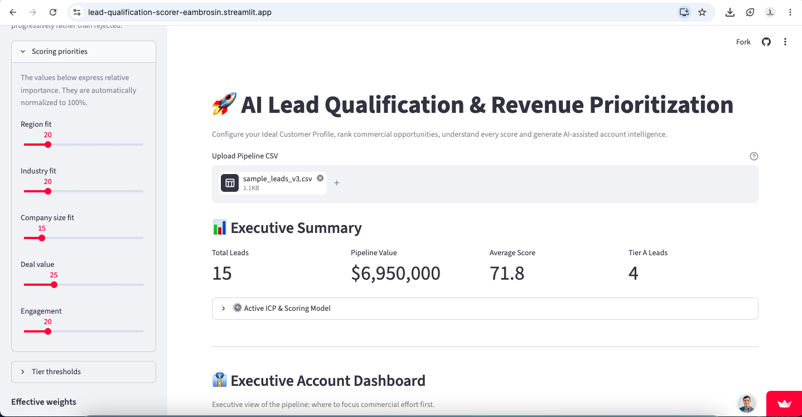
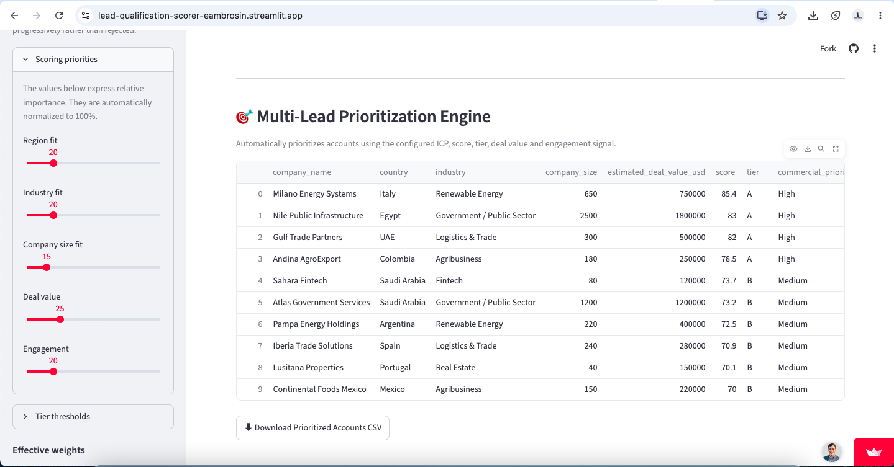
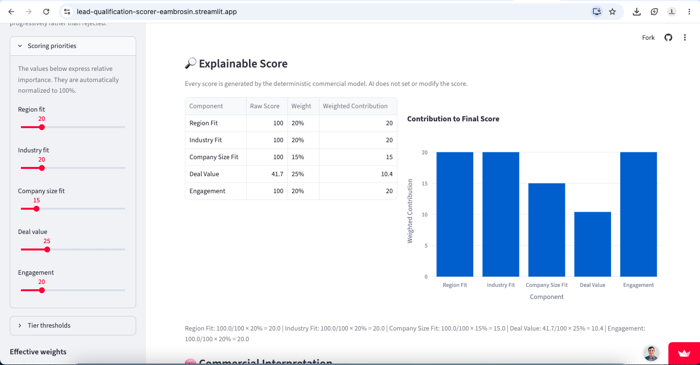
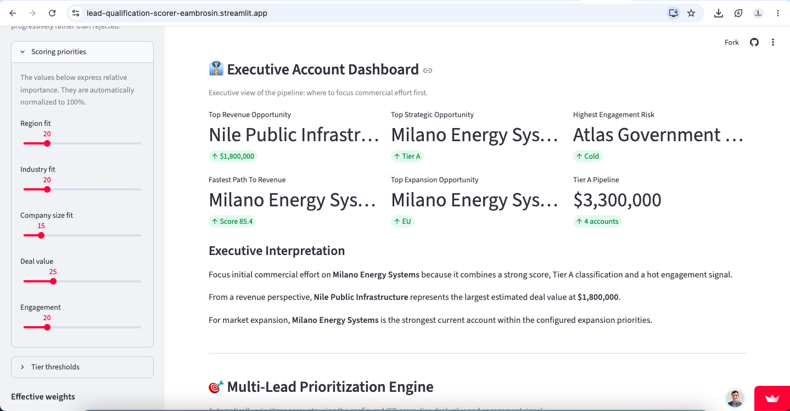
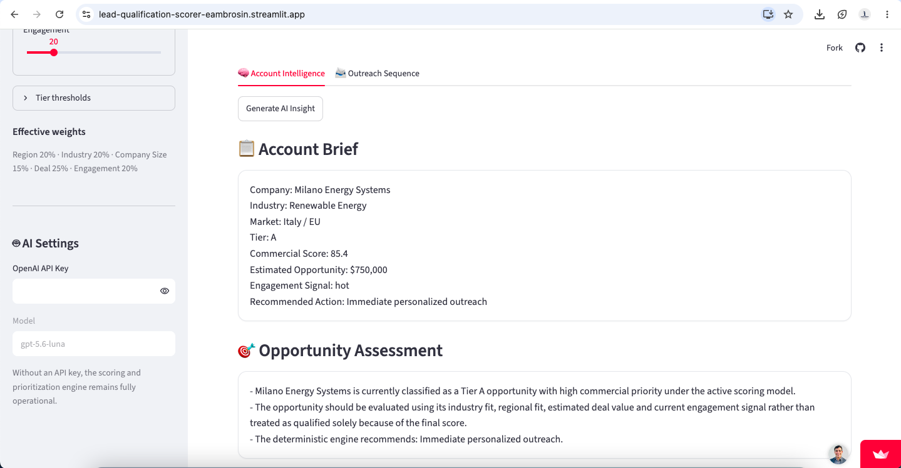

# Counterparty Qualification & Commercial Priority

### Mandate-Aware ICP Scoring | Explainable Prioritization | Buyer & Partner Routing

**Operational focus:** Counterparty Qualification & Commercial Priority

[](https://lead-qualification-scorer-eambrosin.streamlit.app/)


[](https://github.com/Eambrosin/lead-qualification-scorer/actions/workflows/ci.yml)
[](LICENSE)

A Commercial Intelligence application for qualifying and prioritizing buyers, partners and commercial opportunities inside a shared Commercial Mandate using configurable ICP logic, transparent scoring, revenue context and evidence-aware next actions.

> **Prioritize with explainable commercial logic. Use AI to assist interpretation — not to silently decide which account matters most.**

**[Launch the live application](https://lead-qualification-scorer-eambrosin.streamlit.app/)**

---


## Ambrosin Commercial Mandate Workspace

PRIORITIZE operates inside the shared **Commercial Mandate Workspace**.

A saved mandate can be selected directly in the app or opened automatically from IDENTIFY through an opaque **mandate_id**. After **Private Workspace Access** is granted, the app restores the canonical client, corridor, product, target market and counterparty focus from the private Supabase-backed workspace. Portable JSON remains available as an optional override / fallback.

The mandate is visible **before a pipeline CSV is uploaded**, so qualification always starts with the commercial context already in view.

Progression is role-aware:

```text
BUYERS
IDENTIFY → PRIORITIZE → ENGAGE

PARTNERS
IDENTIFY → PRIORITIZE → PARTNER → ENGAGE

BUYERS + PARTNERS
IDENTIFY → PRIORITIZE
                    ├─ qualified buyers → ENGAGE
                    └─ partner candidates → PARTNER → ENGAGE
```

The app does not force every counterparty into the same downstream path.

---

## Business Problem

Commercial teams often have more leads than they can work effectively.

Typical problems include:

- inconsistent qualification criteria
- subjective prioritization
- revenue potential disconnected from ICP fit
- weak visibility into why an account received a score
- generic next actions
- research gaps treated as certainty
- outreach starting before enough qualification context exists

The platform turns raw pipeline inputs into an explainable commercial priority queue.

---


## Commercial Workflow

```text
COMMERCIAL MANDATE
        ↓
PIPELINE / IDENTIFY HANDOFF
        ↓
ICP + UPSTREAM FIT
        +
REGION / INDUSTRY / COMPANY SIZE
        +
COMMERCIAL VALUE / ENGAGEMENT
        ↓
EXPLAINABLE SCORE
        ↓
PRIORITY TIER
        +
QUALIFICATION CONTEXT
        ↓
ROLE-AWARE NEXT ACTION
        ├─ BUYER → ENGAGE
        └─ PARTNER → PARTNER → ENGAGE
```

The objective is not simply to create a number. It is to make **why the account matters, what is still unknown and where it should go next** visible and actionable.

---

## Current Interface

The current live interface is organized around:

1. **ICP & Scoring** — configure preset, priority regions / industries, company-size range, weights and tier thresholds.
2. **AI Settings** — optional interpretation layer; deterministic scoring remains fully operational without an API key.
3. **Saved Commercial Mandate** — restore the mandate from the shared private workspace.
4. **Commercial Mandate Workspace** — view the active mandate, current stage and role-aware progression.
5. **Pipeline Upload** — load an IDENTIFY export or another compatible qualification CSV.
6. **Explainable Prioritization** — review weighted scoring, tiering, rationale, gaps and next actions.
7. **Downstream Handoff** — move qualified buyers to ENGAGE and partner candidates to PARTNER.

The live interface is the source of truth for the current Workspace shell; existing screenshots focus on the underlying analytical views.

---

## Product Preview

### 1. Executive Commercial Intelligence



A concise view of pipeline quality, priority distribution and commercial concentration.

### 2. Multi-Lead Prioritization Engine



Ranks opportunities using configurable ICP and commercial criteria while preserving the score breakdown.

### 3. Explainable Commercial Score



Shows how each factor contributes to the total score so users can challenge or adjust the logic.

### 4. Executive Account Dashboard



Combines company context, revenue potential, fit and recommended action in one account view.

### 5. AI-Assisted Account Intelligence



Adds optional interpretation and communication support after the deterministic qualification layer.

---

## Core Capabilities

- configurable Ideal Customer Profile
- reusable ICP presets
- weighted commercial scoring
- explainable score breakdown
- shared Ambrosin Mandate Workspace navigation
- buyer / partner counterparty context
- counterparty priority tiers
- revenue-prioritization context
- multi-lead ranking
- executive account dashboard
- account intelligence workspace
- evidence-aware research readiness
- recommended next action
- optional AI-assisted account intelligence
- role-aware downstream routing to ENGAGE or PARTNER
- CSV import / export
- automated tests and GitHub Actions CI
- full-history secret scanning

---

## Commercial Mandate Context

When the pipeline comes from IDENTIFY, PRIORITIZE preserves the shared mandate context including commercial corridor, represented company, product, buyer / partner focus, route-to-market hypothesis and trade-feasibility status. A portable Commercial Mandate JSON can also be loaded separately and applied to an uploaded pipeline.

The core question becomes:

> **How relevant is this counterparty to this specific mandate, and what should happen next?**

The score remains deterministic. Mandate context provides commercial meaning; it does not silently alter evidence or invent fit.

---

## Decision Model

The system separates four questions:

**Fit**  
How closely does the opportunity align with the configured ICP?

**Commercial Priority**  
How much attention should the account receive relative to the rest of the pipeline?

**Revenue Context**  
How meaningful is the opportunity from a commercial-value perspective?

**Readiness / Next Action**  
Is there enough information to engage, qualify further or hold the account for research?

A high score does not automatically become an external claim or a buying-intent assumption.

---

## Explainable Scoring

The scoring model is deterministic and configurable.

A typical profile can weight dimensions such as:

- region priority
- industry fit
- company-size fit
- engagement
- commercial value
- research readiness

The exact weighting can be adapted to the sales motion instead of being hard-coded as a universal model.

```text
CONFIGURED INPUTS
      ↓
WEIGHTED COMMERCIAL LOGIC
      ↓
SCORE CONTRIBUTIONS
      ↓
TOTAL SCORE
      ↓
PRIORITY + NEXT ACTION
```

Every score should be explainable back to observable or explicitly supplied inputs.

---


## PRIORITIZE → ENGAGE / PARTNER

PRIORITIZE preserves the same Commercial Mandate while determining what should happen next.

Useful handoff context includes:

- company / account identity
- counterparty role
- Commercial Mandate context
- commercial priority and tier
- score rationale
- fit summary
- revenue context
- recommended action
- qualification gaps
- available public contact context
- language / region context where available

**Buyer / end-customer candidates** progress to **ENGAGE** when commercially ready.

**Route-to-market / partner candidates** progress to **PARTNER** for market-access and execution-feasibility assessment before ENGAGE.

**ENGAGE:** [Business Development Execution & Outreach](https://github.com/Eambrosin/outreach-sequence-generator)  
**PARTNER:** [Route-to-Market & Partner Intelligence](https://github.com/Eambrosin/partnership-opportunity-finder)

---


## Architecture

```text
app.py
  ↓
commercial_mandate.py
  ↓
workspace_persistence.py / mandate_workspace.py
  ↓
qualification_profiles.py
  ↓
lead_qualifier.py / integrated_scoring.py
  ↓
ai_insights.py
  ↓
ENGAGE / PARTNER handoff
```

Commercial scoring remains deterministic and inspectable. Shared workspace persistence restores context; optional AI assists interpretation without replacing the scoring model.

---

## Testing

The repository includes automated tests for:

- qualification logic
- integrated scoring
- AI-insight fallbacks
- priority behavior
- input handling

Run locally:

```bash
python -m pytest -q
```

GitHub Actions runs CI on pushes and pull requests to `main`.

---

## Running Locally

```bash
git clone https://github.com/Eambrosin/lead-qualification-scorer.git
cd lead-qualification-scorer
pip install -r requirements.txt
streamlit run app.py
```

Optional AI features require the relevant API key in environment variables or Streamlit secrets.

---


## Current Version

**Main branch — Workspace-enabled PRIORITIZE**

The tagged v2 release established configurable qualification and explainable scoring. The current main branch adds:

- shared private Commercial Mandate persistence
- automatic `mandate_id` restoration
- mandate display before pipeline upload
- buyer / partner role-aware progression
- protected cross-app handoff
- compatibility with IDENTIFY exports and downstream PARTNER / ENGAGE execution

The main branch therefore extends the tagged release without presenting a new release number that has not been published.

---

## Documentation

- [Detailed Technical Reference](docs/TECHNICAL_REFERENCE.md)
- [Tests](tests/)
- [Commercial Intelligence Portfolio](https://github.com/Eambrosin)

---

## Limitations

This is a portfolio and decision-support application, not an autonomous CRM or autonomous sales system.

Human review remains necessary before:

- changing qualification policy
- acting on incomplete information
- using generated account interpretations externally
- assigning final commercial priority in high-stakes contexts

---

## Portfolio Context

This project is the **PRIORITIZE** layer of the Commercial Intelligence portfolio:

```text
IDENTIFY → PRIORITIZE → ENGAGE
IDENTIFY / Partner Universe → PARTNER → ENGAGE
```

**IDENTIFY:** [Opportunity Discovery Intelligence](https://github.com/Eambrosin/opportunity-discovery-intelligence)  
**ENGAGE:** [Adaptive Outreach Intelligence](https://github.com/Eambrosin/outreach-sequence-generator)  
**Portfolio:** [github.com/Eambrosin](https://github.com/Eambrosin)

---

## Author

**Eduardo Ambrosin**  
International Business Development | Strategic Partnerships | GTM | Commercial Intelligence
